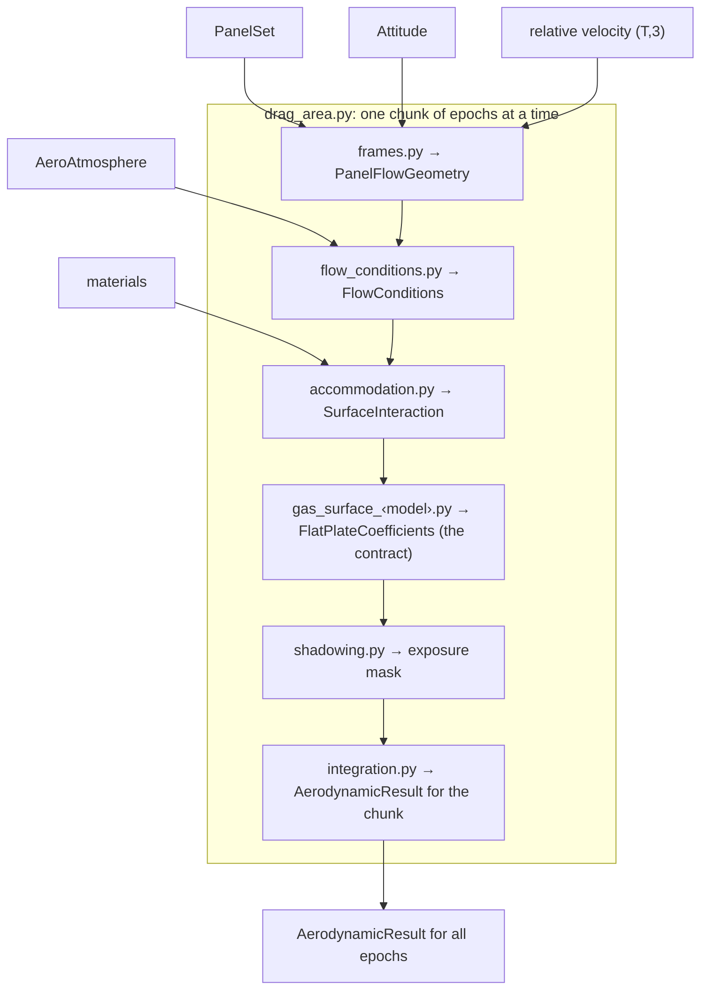

# aero development plan

How `leodragkit.aero` grows from one flat plate into a free-molecular panel solver: models, geometry, shadowing, outputs, validation and order of work. It merges two documents, the drag-coefficient primer (`docs/methods/drag_coefficient_primer.md`) and a standalone-library plan written for a separate package ("Standalone Free-Molecular Spacecraft Aerodynamics Library", 2026), adapted so aero lives inside leodragkit under its rules. Agreed choices are recorded as decisions (`D-NN`); open ones are listed at the end. The task list is in `docs/tasks.md`.

## 1. What aero computes

For each epoch: the aerodynamic force-coefficient vector of a satellite, with drag, lift and side force derived from it, the moment-coefficient vector when panel positions are known, Cd·A, and B(t) = Cd·A(t)/m (D-21, D-39). Inputs are a geometry, materials, attitude, the relative velocity, and the atmosphere's temperature and composition. Density is never an input: aero gives coefficients, and a density model gives ρ.

It is a free-molecular panel method. It is valid while molecules do not collide near the satellite (Knudsen number Kn ≥ 10, comfortably true at 400–600 km), for convex shapes or shapes where shadowing captures the concavity, and it ignores molecules that bounce from one panel to another. Results carry this in their metadata, with the speed-ratio range seen, so no result is presented as more valid than it is.

## 2. Where the two plans differ, and what we chose

| Topic | Standalone plan | Primer / earlier aero | Chosen (decision) |
| --- | --- | --- | --- |
| Packaging | own package `space_aero` with sub-packages | `leodragkit.aero`, numpy and scipy only | `leodragkit.aero`, flat modules, numpy and scipy only (D-03, D-04) |
| Atmosphere | `AtmosphereProvider` interface, MSIS optional | `DensityModel` + `AtmosphereState` (D-10) | Unchanged: aero takes arrays; workflows fetch the atmosphere (D-04, D-10) |
| Outputs | force vector authoritative; CL, side force, moments | drag only (D-26) | Force vector authoritative; moments when positions exist (D-39, supersedes D-26) |
| Gas-surface models | Sentman and DRIA as separate P0 models; CLL P0 | Sentman (DRIA) only | Sentman first, then DRIA and CLL; Newton and Cook only as tests (D-40) |
| Geometry | triangle meshes from STL/OBJ | panel tables | Canonical panel set; YAML component descriptions, macro-model tables and STL/OBJ all build it; own code, trimesh only in tests (D-41) |
| Moving parts | not addressed | not addressed | Named rigid components with a per-epoch pose, designed in now and built after CHAMP validation (D-42) |
| Flow | relative velocity with Earth rotation and winds | co-rotating, no winds (D-25) | Relative-velocity vector per epoch; never a speed derived from altitude (D-44) |
| Databases, speed, constellations | milestones M10–M12 | none | Parked; everything vectorised over epochs and panels (D-43) |

**Sentman and DRIA are one formula.** ADBSat's `coeff_sentman.m` applies the plate formula with one mean molecular mass; its `coeff_DRIA.m` applies the same formula per species and mass-weights the results. Dey et al. (2025a, eq. 2.3) write the DRIA plate in another form; it equals our Sentman form exactly when the reflected-speed constant is 2/3 (R-02). So DRIA is Sentman plus a mixture rule and an accommodation model, not new physics.

**ADBSat assumes a circular orbit in its built-in environment.** `toolbox/calc/environment.m` says it assumes a circular orbit without co-rotation or winds and sets `vinf = sqrt(mu_E/(R_E + h))`; it also fixes the year 2002 in its NRLMSISE-00 call. Supplying the parameters directly bypasses this, but ADBSat's attitude is still only angle of attack and sideslip against a flow along −x, with no crossflow. ADBSat-PyVersion keeps the same line. Ignoring Earth's rotation alone changes the relative speed by up to about 6% and the flow direction by up to about 3.5° (derived, not from a source); eccentricity changes the speed by about ±e·v. aero therefore takes the relative-velocity vector itself (D-44), and ADBSat comparisons feed both codes the same explicit speed and flow direction.

## 3. Modules

All in `leodragkit/aero/`, one level deep. Gas-surface models share the prefix `gas_surface`, so they sort together (D-55). File readers live in `leodragkit/io/`; aero receives arrays and its own small types.

| Module | Holds | First task |
| --- | --- | --- |
| `gas_surface.py` | the contract `FlatPlateCoefficients`; the model signature and the name-to-function table | A1 (contract), A5 (table) |
| `gas_surface_sentman.py` | Sentman plate: reflected-speed ratio, pressure, shear and drag coefficients | A1 |
| `geometry.py` | `PanelSet`: per-panel normals, areas, component and material ids; centroids and triangles when known; validation | A3 |
| `geometry_builder.py` | primitives (plate, box, cylinder) as triangles with a resolution setting; component descriptions and macro-model tables → `PanelSet` | A3 |
| `materials.py` | surface properties per material: wall temperature, accommodation parameters, surface-atom mass | A3 |
| `frames.py` | `Attitude` and its construction from quaternions (Q-13); a simple velocity-and-nadir attitude law; component poses; `PanelFlowGeometry` | A4 |
| `flow_conditions.py` | `AeroAtmosphere` (aero's atmosphere input) and `FlowConditions` (speed ratios per species, mass fractions) | A4 |
| `accommodation.py` | `SurfaceInteraction`: constant values first, Walker/Langmuir surface coverage later | A5 (constant), A9 (Walker) |
| `integration.py` | sums panels into force and moment vectors; drag, lift, side force; Cd·A; `AerodynamicResult` | A5 |
| `drag_area.py` | the public entry: runs the chain one chunk of epochs at a time; B(t) and averaging | A5 |
| `shadowing.py` | which panels are hidden upstream: the exposure mask | A6 |
| `gas_surface_dria.py` | DRIA: the Sentman plate per species, mass-weighted, k = 2/3 | A8 |
| `gas_surface_cll.py` | CLL: Storch's one-sided plate force | A10 |

In `leodragkit/io/`: `mesh_files.py` (STL binary and ASCII, OBJ with polygon faces split into triangles) and `geometry_files.py` (YAML component descriptions and macro-model tables), following the four-function template.

## 3a. Data flow, types and contracts

### The chain

`drag_area.py` runs these stages in order, one chunk of epochs at a time, and joins the chunks at the end (D-53, D-54). Each arrow carries the type named in the next box.

`PanelSet` also reaches `shadowing.py` (triangles) and `integration.py` (areas, normals, centroids). Shadowing comes after the model, so per-panel results can show what a hidden panel would have contributed (D-53).

### Types

All are frozen dataclasses, except the exposure mask, which is a boolean array. Shapes use T epochs (in a chunk), N panels and S gas species.

| Type | Made by | Holds (shape) | Notes |
| --- | --- | --- | --- |
| `PanelSet` | `geometry_builder.py`, from YAML, a macro model or a mesh | outward unit normals (N,3); areas in m² (N,); component and material ids (N,); component and material names; optional centroids (N,3) and triangle vertices (N,3,3) | body frame, metres. Triangles wherever vertices exist; macro models are vertex-free panels, with no shadowing (D-56) |
| `Attitude` | the workflow, via `frames.attitude_from_quaternions` or an attitude law | times (T,); `body_from_reference`, a scipy `Rotation` of T rotations; reference-frame name; source | proposed, Q-13. Quaternion conventions are required arguments with no defaults (D-27) |
| relative velocity | the workflow, from orbit states | (T,3) m/s in the attitude's reference frame | relative to the co-rotating atmosphere; never derived from altitude (D-25, D-44). `drag_area.py` checks the frame label matches the attitude's |
| `AeroAtmosphere` | the workflow, from `density.AtmosphereState` | temperature in K (T,); species masses in kg (S,); number densities in m⁻³ (T,S); source-model name | aero's own type, so aero never imports density (D-04). The mixed-model warning is raised when it is built (D-12) |
| `PanelFlowGeometry` | `frames.py` | cos δ (T,N); shear directions t̂ (T,N,3); flow direction (T,3); speed (T,); per-epoch centroids (T,N,3) when known | components placed at their pose for every epoch (D-42) |
| `FlowConditions` | `flow_conditions.py` | speed ratio per species (T,S); mean speed ratio (T,); mass fractions (T,S); temperature (T,) | its own stage, because the speed ratio drives the physics (D-53) |
| `SurfaceInteraction` | `accommodation.py` | per panel and epoch: α (T,N), or σ_n and σ_t (T,N); wall temperature (T,N); for Walker, the coverage θ (T,) and a second, clean-surface set | the materials table supplies wall temperature and surface-atom mass |
| `FlatPlateCoefficients` | a gas-surface model | C_p, C_τ, C_d (T,N) | **the contract** (D-50, D-52) |
| exposure mask | `shadowing.py` | boolean (T,N) | all true, flagged in metadata, when the `PanelSet` has no triangles |
| `AerodynamicResult` | `integration.py`, joined by `drag_area.py` | force-coefficient vector in the body frame (T,3); drag, lift, side-force coefficients (T,); moment-coefficient vector (T,3) or none; reference area and length; projected area (T,); Cd·A in m² (T,); B in m²/kg (T,) when a mass is given; optional per-panel contributions; metadata | the force vector is authoritative (D-39); metadata names the model, accommodation, k, materials, geometry source, whether shadowing and moments were possible, the speed-ratio range and any mixed-model warning |

### Contracts

1. Every gas-surface model returns `FlatPlateCoefficients` for one-sided plates, referenced to each panel's own area, with the signs of D-50. `integration.py` never knows which model ran.
2. Every model has one signature, `(PanelFlowGeometry, FlowConditions, SurfaceInteraction) → FlatPlateCoefficients`, and `drag_area.py` looks it up by name in a plain dictionary. DRIA calls the Sentman plate once per species and mass-weights; the Walker model blends two results with θ. Both still return the contract.
3. `PanelSet` is the only geometry the solver sees, however it was built.
4. aero takes arrays and its own small types, never density or Orekit objects (D-04). The workflow translates.
5. Back faces keep their sign; nothing is clipped (D-38).
6. Every stage works on a chunk of epochs and is vectorised over epochs and panels, with no Python loop over panels (D-54).

### Outside aero: the workflow

`workflows/drag_area_from_attitude.py` builds the inputs:

- reads the geometry and attitude files with `io`;
- gets the atmosphere from `density` (MSIS) and converts it to `AeroAtmosphere`;
- computes the relative velocity from the orbit states, expressed in the attitude's reference frame (Orekit, in `orbit/`);
- calls `drag_area.py`;
- returns the result, with `save_*`, `load_*` and the input records (D-15, D-16).

### Where each task fits

| Task | Part of the chain |
| --- | --- |
| A1 | `gas_surface.py` (the contract) and `gas_surface_sentman.py` |
| A2 | checks of the Sentman model |
| A3 | `PanelSet`, the builder and materials |
| A4 | `frames.py` (`Attitude`, `PanelFlowGeometry`) and `flow_conditions.py` |
| A5 | constant `SurfaceInteraction`, `integration.py`, `drag_area.py` with chunking and a timing benchmark, and the workflow |
| A6 | `shadowing.py` |
| A7 | `AeroAtmosphere` built from `AtmosphereState` in the workflow |
| A8, A10 | `gas_surface_dria.py`, `gas_surface_cll.py` |
| A9 | Walker accommodation in `accommodation.py` |

## 4. Physics

### 4.1 Models

| Model | Equations | Inputs per panel | Notes |
| --- | --- | --- | --- |
| Sentman | Sinpetru et al. 2022a, eqs. 6–7 (primer, steps 2–3) | cos δ, s, r from α, T_w, T∞ | One mean molecular mass. k = 1/2 by default (D-45) |
| DRIA | the same plate per species, mass-weighted (Mehta et al. 2023, eq. 11; Dey et al. 2025a, eqs. 2.3–2.4) | as Sentman, per species | k = 2/3, as published (D-45) |
| CLL | Storch 2002, eq. 3.9 and §3.2.2 (one-sided plate force); drag form in Dey et al. 2025a, eq. 2.7 | cos δ, s, σ_n, σ_t, T_w, T∞ | σ_n = σ_t = 1 is diffuse; 0 is specular. σ_n from Walker eq. 27 (D-46) |
| Newton, Cook | Sinpetru et al. 2022a, eqs. 18, 20–21 | | Tests only. Newton is Sentman's r = 0 limit; Cook has the form of Sentman's hyperthermal limit, with a re-emission term smaller by 3√(πk)/4 (R-04) |

Two identities hold to machine precision and become tests (R-02): Dey's DRIA plate (eq. 2.3) equals our Sentman form with k = 2/3, and at full accommodation it equals the CLL plate (eq. 2.7) with σ_n = σ_t = 1.

### 4.2 Accommodation

Constant values first: α for Sentman and DRIA; σ_n and σ_t (or α_n) for CLL. Then the Walker model as Dey et al. (2025a, eqs. 2.10–2.15) apply it, after Walker et al. (2014) and Pilinski et al. (2010):

- Surface coverage by atomic oxygen θ = K P_O / (1 + K P_O), with P_O = n_O k_B T∞. Walker et al. (2014) give K in Pa⁻¹: 1.44 × 10⁶ for DRIA and 2.89 × 10⁶ for CLL, fitted to spherical satellites at 200–500 km.
- Each panel's coefficient is θ C_ads + (1 − θ) C_clean, computed with separate accommodation for the two surfaces.
- Oxygen-covered surface: α = 1; for CLL σ_n = σ_t = 1.
- Clean surface: Goodman's α_s = K_s μ/(1+μ)², μ the gas-to-surface-atom mass ratio, K_s = 3.0 (Dey et al., citing Mehta et al. 2017). For CLL, σ_t = 0.8, α_n = 2α − 1 (floored at 0) and σ_n = 1 − √(1 − α_n) (Walker et al. 2014, eq. 27).

These constants are model data with their source recorded, never generic constants. The surface-atom mass is a material property.

### 4.3 Gas mixtures

Sentman uses one mean molecular mass. DRIA and CLL work per species, each with its own speed ratio, and combine by mass fraction. Species and temperature come from `AtmosphereState` through the workflow (D-10, D-12).

## 5. Geometry

**One canonical form.** Every geometry becomes a `PanelSet`: per panel a unit outward normal, an area, a component id and a material id; and, when known, a centroid and the triangle's vertices. The solver uses only what the set has. Without positions it gives forces but no moments and no shadowing, and says so in the result's metadata.

**Three ways in:**

1. **Component description** (YAML in the `geometry` data directory). Named components built from primitives (plate, box, cylinder), each with a size, a pose in the body frame, a material and, for thin plates, a two-sided flag. This is the cubesat-and-deployables route, and the part with no off-the-shelf tool. Primitives are built as triangles, with a maximum edge length so faces can be refined where shadowing needs it (D-56).
2. **Macro-model table.** Normal, area, material and optional position per panel, as used in precise orbit determination and by Dey et al. (2025a) for GRACE and C/NOFS.
3. **STL or OBJ mesh**, for example the TU Delft CHAMP, GRACE, GOCE and Swarm models, with components and materials assigned by a small mapping file.

**Moving parts.** Components are rigid and named. The solver places every component at its pose for each epoch before computing normals and shadowing. Every pose is fixed until articulation laws (hinge-angle series, Sun tracking) are added in A13 (D-42).

**Our own code, checked against trimesh.** The readers, primitives and transforms are short numpy code. trimesh (MIT) serves as an independent test oracle for areas, normals and ray hits (D-41).

## 6. Shadowing

A panel that faces the flow is shadowed when another surface lies upstream of its centroid. The test projects every centroid onto the plane perpendicular to the flow and asks whether it falls inside an upstream triangle, with the panel's own triangle excluded explicitly. This is the same idea as ADBSat's `shadowAnaly.m`.

Ray casting with a start offset is avoided. In a check on a convex sphere, where nothing can be shadowed, trimesh's ray engines reported up to 3,852 false shadows of 10,240 front faces at a 10⁻⁶ offset and none at 10⁻⁴: the answer depended on a size-dependent tolerance (exploration, not logged as a result).

Shadowing is per panel, all or nothing, so accuracy comes from refining the mesh. Comparing every panel with every other suits thousands of triangles; faster search belongs with the parked performance work.

## 7. Outputs

An `AerodynamicResult` over epochs holds:

- the force-coefficient vector in the body frame, the authoritative result;
- drag, lift and side-force coefficients in the wind frame;
- the moment-coefficient vector about a stated point, when positions exist;
- the reference area and length, and the projected area;
- Cd·A, and B when a mass is given;
- optionally, per-panel contributions;
- metadata: the model, accommodation, k, materials, geometry source, whether shadowing and moments were possible, the speed-ratio range, and a mixed-model warning when it applies.

Back-facing panels keep their sign (D-38).

## 8. Validation ladder

Software verification ("did we implement the equations?") comes before physical validation ("do they describe the satellite?").

| Rung | Check | Reference | Task |
| --- | --- | --- | --- |
| V0 | Structural properties of the plate | limits, signs, broadcasting | A1 |
| V1 | Plate identities | Dey eq. 2.3 = Sentman with k = 2/3; DRIA(α = 1) = CLL(1, 1); Sentman's hyperthermal limit, and its fixed difference from Cook | A2, A8, A10 |
| V2 | Sphere | Bird / Dey eq. 2.5 (DRIA), Dey eq. 2.8 (CLL), by quadrature and by meshed spheres | A2, A5, A10 |
| V3 | Boxes, plates in front of boxes, L-shapes | hand calculation; trimesh areas, normals and ray hits | A3, A5, A6 |
| V4 | ADBSat | MATLAB ADBSat or ADBSat-PyVersion, run with explicit speeds, for plate, cube and sphere and each model | A11 |
| V5 | Published spacecraft values | Dey et al. 2025a, GRACE and C/NOFS macro models | A12 |
| V6 | CHAMP and GRACE | TU Delft geometry and SPARTA (DSMC) tables; accelerometer densities | A12 |
| V7 | Spire | contigo_edr | after A12 |

## 9. Parked

- Coefficient databases and interpolation.
- Further performance work: faster shadowing search, Numba or JAX, parallel batches. Chunking and vectorising are not parked: they are built in from the start (D-54).
- Constellations.
- Multiple reflections and concave interiors.
- Analytic components: closed-form spheres and cylinders inside a satellite, as Dey et al. use for booms (Q-11).
- Neutral winds.

Each comes back by decision when a workflow needs it (D-43).

## 10. Open questions

- **Q-13.** The attitude input: the canonical form, a simple attitude law in `frames.py`, and data gaps (`docs/decisions.md`).

## References

The primer's reference list holds the sources for steps 1–6. Added here:

- Dey, S., Anderson, P., Bukowski, A., & Pilinski, M. (2025a). Investigation of gas-surface interactions and neutral atmospheric properties and their impact on satellite drag coefficients. *Earth and Space Science*, 12, e2024EA003998. doi:[10.1029/2024EA003998](https://doi.org/10.1029/2024EA003998). CC BY 4.0.
- Dey, S., Anderson, P., Pilinski, M., Sutton, E., & Bukowski, A. (2025b). An extreme events study of the storm-time variations in satellite drag coefficients. *Space Weather*, 23, e2025SW004634. doi:[10.1029/2025SW004634](https://doi.org/10.1029/2025SW004634). CC BY 4.0.
- Mehta, P. M., Walker, A., McLaughlin, C. A., & Koller, J. (2014). Comparing physical drag coefficients computed using different gas–surface interaction models. *Journal of Spacecraft and Rockets*, 51, 873–883. doi:[10.2514/1.A32566](https://doi.org/10.2514/1.A32566).
- Walker, A., Mehta, P., & Koller, J. (2014). Drag coefficient model using the Cercignani–Lampis–Lord gas–surface interaction model. *Journal of Spacecraft and Rockets*, 51, 1544–1563. doi:[10.2514/1.A32677](https://doi.org/10.2514/1.A32677).
- ADBSat-PyVersion, [github.com/jovbos2208/ADBSat-PyVersion](https://github.com/jovbos2208/ADBSat-PyVersion): a file-by-file Python port of ADBSat, stated as GPL-3.0 in its README. Run for comparison numbers only; never read for code.
- Storch, J. A. (2002). *Aerodynamic disturbances on spacecraft in free-molecular flow*. The Aerospace Corporation, Aerospace Report No. TR-2003(3397)-1, SMC-TR-03-06, 17 October 2002. Approved for public release, distribution unlimited. No DOI or ISBN; cited as D-49 requires. Read: a scanned copy uploaded to the project; eqs. 2.1, 3.7–3.9 and §3.2.2.
- trimesh, [github.com/mikedh/trimesh](https://github.com/mikedh/trimesh), MIT. Test oracle only.

Citation check (2026-10-29). All DOIs above were resolved through Crossref, with title, authors, venue and year matched. Read in the uploaded PDFs: Dey et al. 2025a, eqs. 2.1–2.16 (pages 5–7); Walker et al. 2014, eqs. 27–29, Tables 3–4 and the Pa⁻¹ unit of K; Mehta et al. 2014, its abstract figures; Pilinski et al. 2010, the Langmuir form in n_O T. Storch (2002) was read from a scanned copy without a text layer: eqs. 2.1, 3.7–3.9 and §3.2.2. Its eq. 2.2, the mean normal speed of wall-temperature molecules, is to be read in A10. Not yet read: Dey et al. 2025b beyond its abstract.
