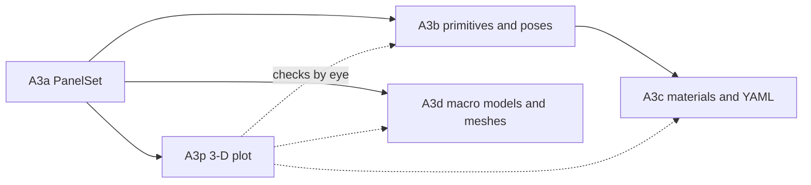

# A3: Geometry, overview of the split

A3 builds everything that turns a description of a spacecraft into the one geometry the solver sees, a `PanelSet` (D-41, D-56). It is too large for one step, so it is split into five sub-steps, each with its own plan in `docs/plans/` (D-51). This overview holds what the sub-steps share: the order, what each one hands to the next, and the conventions all of them follow. Read it before writing any A3 sub-step plan.

## The sub-steps

| Step | Builds | Module | Hands on | Depends on |
| --- | --- | --- | --- | --- |
| A3a | `PanelSet` from triangles (normals, areas, centroids derived) or from bare panels (macro models), with validation | `aero/geometry.py` | `PanelSet`, `panel_set_from_triangles`, `panel_set_from_panels` | A1 |
| A3p | interactive 3-D plot of a `PanelSet`: triangles coloured by component or material, outward normals, body axes; macro-model panels as arrows | `plots/spacecraft.py` | `plot_panel_set_3d` | A3a |
| A3b | primitives (plate, box, cylinder) as outward triangles with a maximum edge length; placing a component at its pose; joining components into one `PanelSet` | `aero/geometry_builder.py` | primitive functions returning triangles; `join_panel_sets` | A3a |
| A3c | materials, and YAML component descriptions → `PanelSet` | `aero/materials.py`, `aero/geometry_builder.py`, `io/geometry_files.py` | `SurfaceMaterial`; `build_panel_set_from_description`; `read_component_description_file` | A3b |
| A3d | macro-model tables and STL/OBJ meshes → `PanelSet` | `io/geometry_files.py`, `io/mesh_files.py` | `read_macro_model_file`; `read_stl_file`, `read_obj_file` | A3a |

A3p comes straight after A3a so every later geometry step can be checked by eye as well as by tests. A3d needs only A3a and can be done before or after A3b and A3c.

## The shared object: `PanelSet`

Every sub-step either builds a `PanelSet` or reads one. Its fields are fixed in A3a and listed in `docs/aero_plan.md`, section 3a:

- per panel: outward unit normals (N,3), areas in m² (N,), component and material ids (N,);
- the component and material names;
- optionally, centroids in m (N,3) and triangle vertices in m (N,3,3);
- a `source` string for provenance.

Positions are optional because macro models carry none; a set without them supports force, but not shadowing or (without centroids) moments (D-56). Later sub-steps add no fields. If one turns out to need a field, that is a change to A3a's contract and needs a decision.

## Conventions every sub-step follows

From `.claude/rules/aero.md`, "Geometry conventions" (D-58, D-59):

- **Outward normals** follow counter-clockwise corner order seen from outside; a stored STL normal that disagrees raises.
- **Degenerate triangles** raise; nothing is dropped silently.
- **Component poses** in YAML are a centre plus the component's x and z axes in the body frame.
- **Mesh length units** are a required argument.
- **Materials** hold name, wall temperature and energy accommodation until A9 and A10 add more.
- **Body frame, metres** for every position.

## Testing across the sub-steps

- Hand-checkable cases first: one triangle, a unit cube, a plate, where areas, normals and centroids are known exactly.
- trimesh is the independent oracle for areas and normals of larger meshes, imported with `pytest.importorskip`, so the suite runs without it (D-60).
- Plots get smoke tests on the figure object (trace counts and kinds), skipped when plotly is absent (D-62).

## Writing each sub-step's plan

Each plan follows `docs/plans/A1_flat_plate.md`: goal, files and who writes them, functions, required reading, work order, tests, traps, and when it is done. It names which conventions above it touches, and states its hand-on (the "Hands on" column) exactly, since the next sub-step builds on it.
