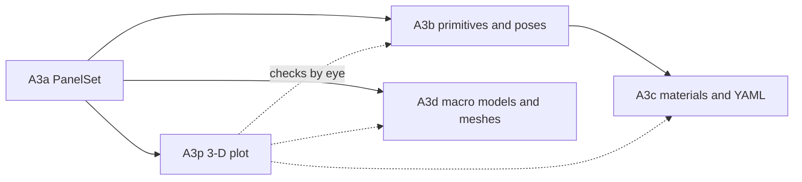

# A3: Geometry, overview of the split

A3 builds everything that turns a description of a spacecraft into the one geometry the solver sees, a `PanelSet` (D-41, D-56). It is too large for one step, so it is split into five sub-steps, each with its own plan in `docs/plans/` (D-51). This overview holds what the sub-steps share: the order, what each one hands to the next, and the conventions all of them follow. Read it before writing any A3 sub-step plan.

## The sub-steps

| Step | Builds | Module | Hands on | Depends on |
| --- | --- | --- | --- | --- |
| A3a | `PanelSet` from triangles (normals, areas, centroids derived) or from bare panels (macro models), with validation | `aero/geometry.py` | `PanelSet`, `panel_set_from_triangles`, `panel_set_from_panels` | A1 |
| A3p | interactive 3-D plot of a `PanelSet`: triangles coloured by component or material, outward normals, body axes; macro-model panels as arrows | `plots/spacecraft.py` | `plot_panel_set_3d` | A3a |
| A3b | primitives (plate, box, cylinder) as outward triangles with a maximum edge length; placing a component at its pose; joining components into one `PanelSet`; the orientation checks | `aero/geometry_builder.py`, `aero/geometry_checks.py` | primitive functions returning triangles; `join_panel_sets`; `summarise_geometry` and the checks | A3a |
| A3c | materials, and YAML component descriptions → `PanelSet` | `aero/materials.py`, `aero/geometry_builder.py`, `io/geometry_files.py` | `SurfaceMaterial`; `build_panel_set_from_description`; `read_component_description_file` | A3b |
| A3d | macro-model tables and STL/OBJ meshes → `PanelSet` | `io/geometry_files.py`, `io/mesh_files.py` | `read_macro_model_file`; `read_stl_file`, `read_obj_file` | A3a |

A3p comes straight after A3a so every later geometry step can be checked by eye as well as by tests. A3d needs only A3a and can be done before or after A3b and A3c.

## The shared object: `PanelSet`

Every sub-step either builds a `PanelSet` or reads one. Its fields are fixed in A3a and listed in `docs/aero_plan.md`, section 3a:

- per panel: outward unit normals (N,3), areas in m² (N,), component and material ids (N,);
- the component and material names;
- optionally, centroids in m (N,3) and triangle vertices in m (N,3,3);
- a `source` string for provenance.

Positions are optional because macro models carry none; a set without them supports force, but not shadowing or (without centroids) moments (D-56). Later sub-steps add no fields. If one turns out to need a field, that is a change to A3a's contract and needs a decision.

## Conventions every sub-step follows

From `.claude/rules/aero.md`, "Geometry conventions" (D-58, D-59):

- **Outward normals** follow counter-clockwise corner order seen from outside; a stored STL normal that disagrees raises.
- **Degenerate triangles** raise; nothing is dropped silently.
- **Component poses** in YAML are a centre plus the component's x and z axes in the body frame.
- **Mesh length units** are a required argument.
- **Materials** hold name, wall temperature and energy accommodation until A9 and A10 add more.
- **Body frame, metres** for every position.
- **Outward orientation is checked**, per component, wherever the geometry allows it (see the next section).

## Checking that normals point outward

A triangle listed clockwise has a normal pointing into the spacecraft. The panel is then treated as facing the other way: a ram face contributes almost no drag, its wake face contributes drag that isn't there, and shadowing tests the wrong side. Cd·A can be badly wrong without any error. Users will describe spacecraft in YAML (A3c) and bring their own tables and meshes (A3d), so orientation is checked rigorously, wherever the geometry allows it (D-66).

For a single triangle, "outward" is only a convention, so no test exists. What can be checked depends on the shape:

| Shape | Check | Failure |
| --- | --- | --- |
| a **closed** component (box, capped cylinder, watertight mesh) | 1. **closed**: after welding corners that coincide (within a tolerance scaled to the component's size), every edge is shared by exactly two triangles | not closed: the next two checks cannot be made; reported, not raised |
| | 2. **consistent**: the two triangles sharing an edge run along it in opposite directions | raise, naming a triangle on each side |
| | 3. **outward**: the signed volume, (1/6)·Σ v₀·(v₁ × v₂), is positive (divergence theorem; it is negative when every normal points inward) | raise, unless the caller passed `reverse_winding=True`, which flips every triangle and records that it did in the `PanelSet`'s `source` |
| an **open** component (a plate, one or two sides) | built from its declared normal (the z axis in YAML), never from user-ordered corners; a two-sided plate is two triangles per facet with opposite normals | tested by construction |
| any panel with a position | **heuristic**: a panel whose normal points towards the spacecraft's centre of area, while its centroid lies outside the body, is listed for a second look | a warning naming the panels, never an error: a deployed panel may face the body on purpose |
| an STL file | each stored normal agrees with its corner order (D-58) | raise |
| a macro model without positions | none possible | the plot (A3p) and the summary show every normal |

The checks run **per component**, never on the union: components may touch, so the union need not be closed. They live in one module, `aero/geometry_checks.py`. It provides a function per check, plus `summarise_geometry(panel_set)`, which returns one row per component: triangles, area, closed or open, consistent, signed volume, and the panels flagged by the heuristic. Every `PanelSet` built in A3b, A3c and A3d passes through the checks, and the tutorial notebook shows the summary next to the plot. trimesh's own winding and volume checks are the test oracle (D-60).

Who adds what:

- **A3b** writes `geometry_checks.py`. It applies the checks to every primitive, and tests them on deliberately broken shapes: one face flipped, all faces flipped, a hole.
- **A3c** applies them to YAML-built spacecraft. It also checks each pose: the x and z axes must be unit length and perpendicular, and y is computed as z × x, so the axes are right-handed by construction.
- **A3d** applies them to meshes and tables, adds the `reverse_winding` option, and reports meshes that are not closed.

## Testing across the sub-steps

- Hand-checkable cases first: one triangle, a unit cube, a plate, where areas, normals and centroids are known exactly.
- trimesh is the independent oracle for areas and normals of larger meshes, imported with `pytest.importorskip`, so the suite runs without it (D-60).
- Plots get smoke tests on the figure object (trace counts and kinds), skipped when plotly is absent (D-62).

## The tutorial notebook

Each sub-step adds a section to `notebooks/aero_tutorial.ipynb` showing what it produces (D-65): A3a and A3p start it with a triangle, a hand-built cube and a macro model; A3b replaces the hand-built cube with primitives; A3c reads the same spacecraft from YAML; A3d loads a mesh file.

## Writing each sub-step's plan

Each plan follows `docs/plans/A1_flat_plate.md`: goal, files and who writes them, functions, required reading, work order, tests, traps, and when it is done. It names which conventions above it touches, and states its hand-on (the "Hands on" column) exactly, since the next sub-step builds on it.
